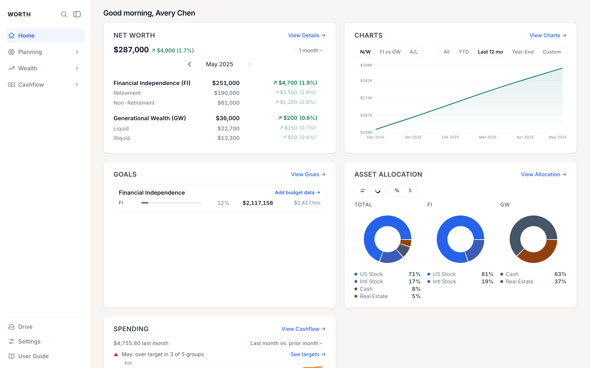

# worth

**Your money, on your own disk, and nowhere else.**

A personal finance app for one person. It runs in your browser and keeps your data as plain files in a folder you choose. Net worth, goals, budget, transactions and tax documents, with no account, no server and no analytics.

[**Open the app**](https://anindya.dev/worth) · [**Read the wiki**](https://github.com/dutta14/worth/wiki)



## Why

Spreadsheets survive but drift. Apps get bought, shut down, or want your bank login. This one is small on purpose: your data is a folder you already know how to back up, and nothing leaves your device.

## Quick start

1. Open [anindya.dev/worth](https://anindya.dev/worth) in Chrome or Edge.
2. Choose an empty folder for your data.
3. Add an account and this month's balance. The rest of the app builds from there.

Step-by-step with screenshots: [Getting Started](https://github.com/dutta14/worth/wiki/Getting-Started).

## Documentation

Everything else lives in the [wiki](https://github.com/dutta14/worth/wiki):

- **Using worth:** Getting Started, Planning, Wealth, Cashflow, Importing Bank CSVs, Taxes and Drive, Settings
- **Your data:** Privacy and Data, Data Folder Layout, Data Safety Net, FAQ, Troubleshooting
- **Contributing:** Architecture, Development Setup, Testing, Feature Flags, CI and Deployment

## Develop

```bash
npm ci
npm run dev   # http://localhost:5173/worth/
```

See [CONTRIBUTING.md](./CONTRIBUTING.md) and the wiki's Development Setup page.

## License

[MIT](./LICENSE)
